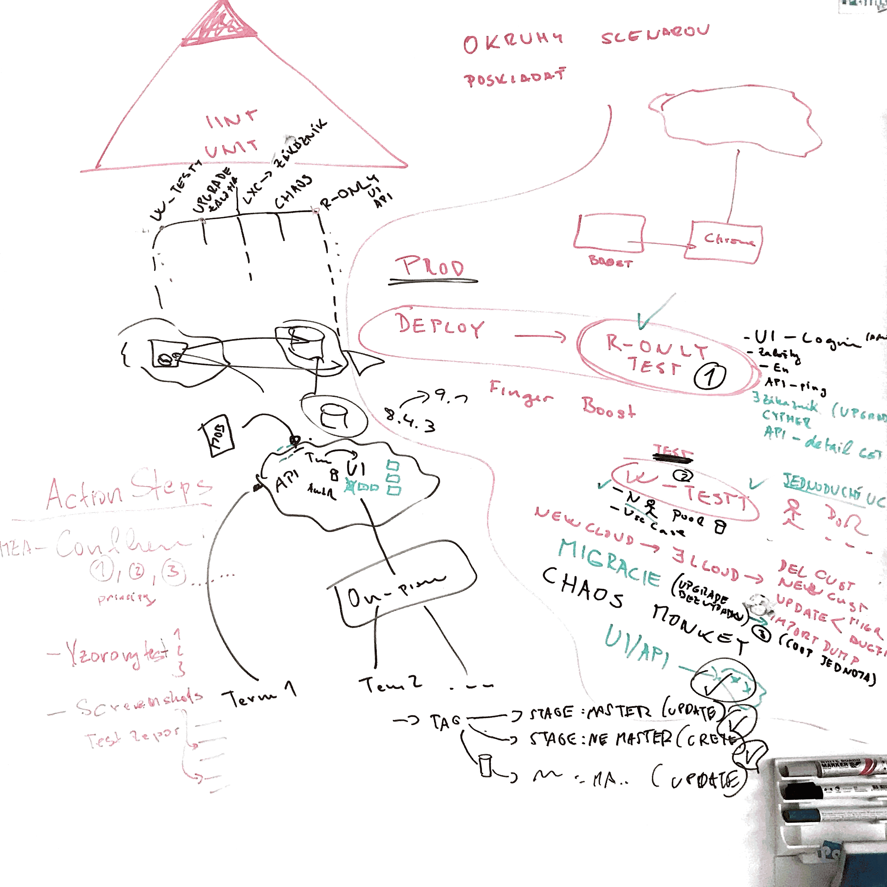
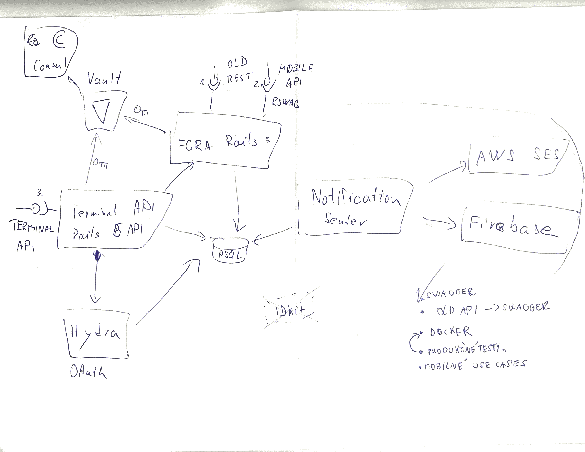
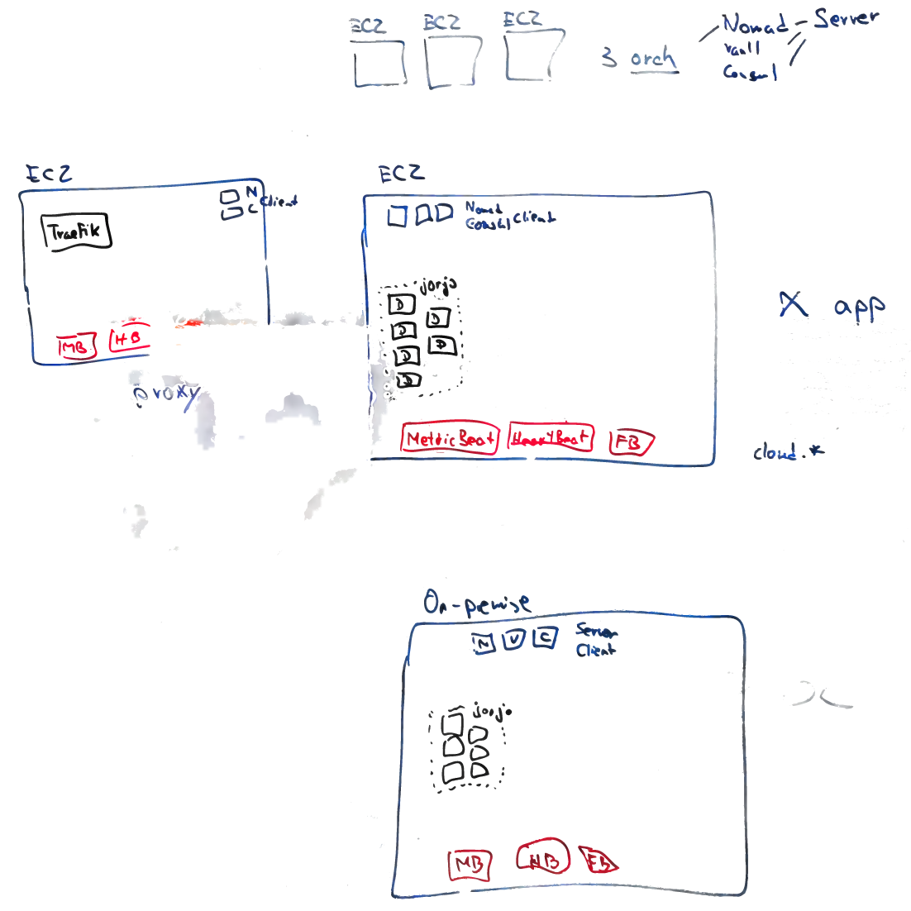

# Innovatrics - Fingera Development 

**Proven experience with SaaS (system as a service)**

## Sprint / Process

## Testing

* Environments:
  * Dev (locally running server - VirtualBox & Vagrant)
  * Staging 
   * Cloud (Nomad)
   * On-premise (Nomad)
* Only me as tester

## Development

### Current Environment

**Fingera current infrastructure:**

* Development (running locally in Docker or in VM (VirtualBox + Vagrant))
* Staging 
  * Cloud (AWS + Ansible)
  * On-premise (VM in local server + Ansible)
* Production
  * Cloud
  * On-premise

### New Environment - Fingera Platform (not in production at the time)

**Fingera platform infrastructure:**

* Staging
  * Cloud (AWS (EC2) + Nomad)
  * On-premise (VM in local server + Nomad)

### Server description

### Technologies

* back-end: RoR
  * database: postgresql
* front-end: vanilla JS (RoR templates) & react 
* monitoring
  * [kibana](https://www.elastic.co/kibana)
  * [elastic-search](https://www.elastic.co/)
  * metrci beat
  * heart beat
* infrastructure: 
  * ansible (old, later move to nomad)
  * [prometheus](https://prometheus.io/)
  * aws
  * docker
  * [hasicorp](https://www.hashicorp.com/products/nomad)
    * vault
    * terraform ?
    * consul ?
    * nomad
    * vagrant ?
* services:
  * hydra (oAuth)
  * API (swagger & apiary):
    * api_smartface (facial recognition)
    * api_terminal (android fingerprint terminal)
    * mobile_api (part of the main app) ?
    * notification_sender
* graphQL
* rest API
* automation testing
  * cypress
    * e2e tests
    * api tests
  * eslint
  * prettier
* GitLab CI (continues integration)
