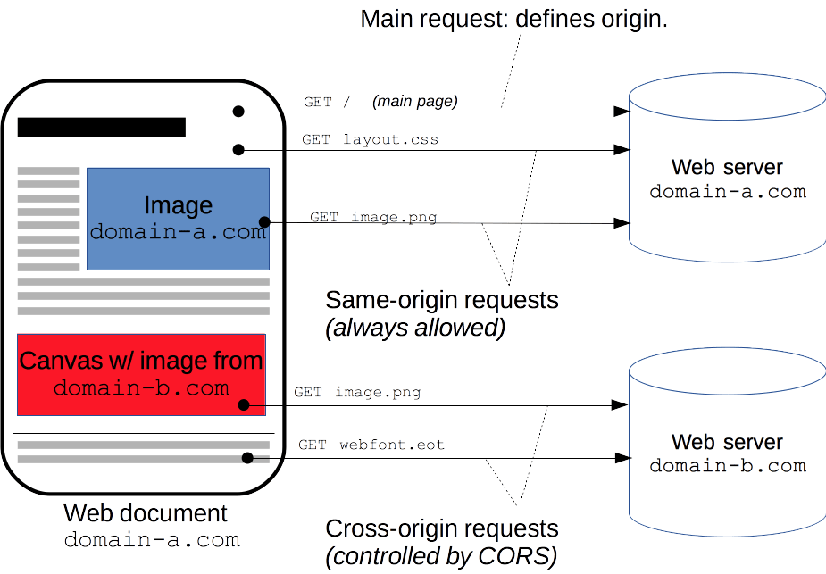
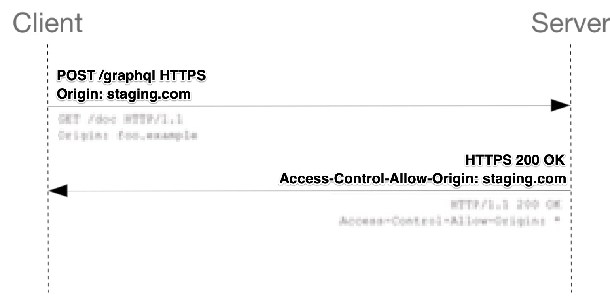

# CROS - Cross-Origin Resource Sharing 

CROS is a system, consisting of transmitting HTTP headers, that determines whether browsers block frontend JavaScript code from accessing responses for cross-origin requests.

links: 

https://developer.mozilla.org/en-US/docs/Web/HTTP/CORS
https://developer.mozilla.org/en-US/docs/Glossary/CORS

An example of a cross-origin request: the front-end JavaScript code served from 
`https://domain-a.com` uses XMLHttpRequest to make a request for `https://domain-b.com/data.json`.

For security reasons, browsers restrict cross-origin HTTP requests initiated from scripts.

The CORS mechanism supports secure cross-origin requests and data transfers between browsers and servers.

The Cross-Origin Resource Sharing standard works by adding new HTTP headers that let servers describe which origins are permitted to read that information from a web browser.

CORS failures result in errors but for security reasons, specifics about the error are not available to JavaScript.

## Example of access control scenario

### Simple request

## See also

* [HTTP Headers](./http-headers.md)
* [XMLHttpRequest](./xhr)
* [Fetch API](./fetch-api.md)
* [Preflight request](./preflight-request.md)
